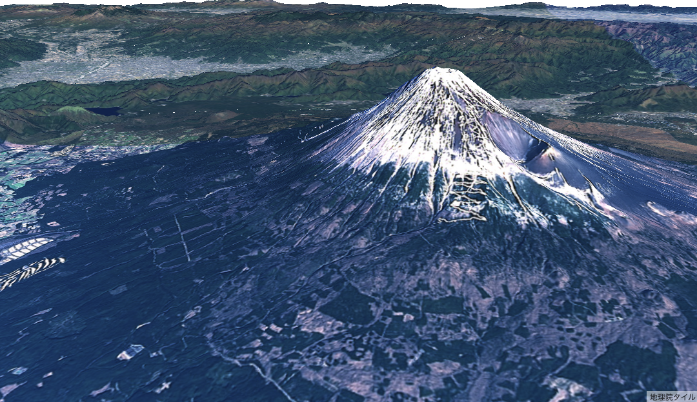

# maplibre-gl-gsi-terrain（BoxPistols フォーク）

MapLibre GL JS で国土地理院の標高タイル（地理院形式の PNG）を 3D 地形として表示するライブラリ [mug-jp/maplibre-gl-gsi-terrain](https://github.com/mug-jp/maplibre-gl-gsi-terrain)（Kanahiro Iguchi ほか）のフォークです。

[](https://github.com/BoxPistols/maplibre-gl-gsi-terrain/actions/workflows/ci.yml)



> **3D フライトシミュレーターは移動しました。** 以前このリポジトリの `example/` にあったドローン飛行シミュレーターは [BoxPistols/gsi-terrain-flight-simulator](https://github.com/BoxPistols/gsi-terrain-flight-simulator) に移し、このライブラリは npm の依存として使っています。

## このフォークでの変更

上流の `src/terrain.ts` と `src/worker.ts` に対して、次の変更を加えています（ユニットテストは `src/terrain.test.ts`）。

- タイルのリクエストを URL ではなく連番の ID で管理し、同じ URL への同時リクエストが取り違えられないようにした
- リクエストごとのタイムアウト（30 秒）と、`AbortController` による中断の後始末
- Web Worker が落ちたときの自動再生成（60 秒以内に 3 回を超えたら無効化）
- `gsidem://https://...` の URL が正規化で `https//` や `https:///` に崩れた場合の修復（`normalizeGsiUrl`）
- 取得したタイルが画像でなかった場合（HTTP 200 で HTML が返る場合など）のエラー処理
- Worker を import 時ではなく初回利用時に作るようにし、SSR やテスト環境でも import できるようにした

npm の `maplibre-gl-gsi-terrain` は上流の作者が公開しているもので、上の変更は含みません。以下の「インストール」「使い方」は上流の README の内容です。

## インストール

### CDN経由

```html
<script type="module">
    import { useGsiTerrainSource } from 'https://www.unpkg.com/maplibre-gl-gsi-terrain@2.1.0/dist/terrain.js';
</script>
```

### npm module として利用する

```sh
npm install maplibre-gl-gsi-terrain
```

## 使い方

```typescript
import maplibregl from 'maplibre-gl';
import { useGsiTerrainSource } from 'maplibre-gl-gsi-terrain';

const gsiTerrainSource = useGsiTerrainSource(maplibregl.addProtocol);
const map = new maplibregl.Map({
    container: 'map',
    style: {
        version: 8,
        center: [139.6917, 35.6895],
        zoom: 10,
        pitch: 30,
        maxPitch: 100,
        sources: {
            terrain: gsiTerrainSource,
            seamlessphoto: {
                type: 'raster',
                tiles: [
                    'https://cyberjapandata.gsi.go.jp/xyz/seamlessphoto/{z}/{x}/{y}.jpg',
                ],
                maxzoom: 18,
                tileSize: 256,
                attribution:
                    '<a href="https://maps.gsi.go.jp/development/ichiran.html">地理院タイル</a>',
            },
        },
        layers: [
            {
                id: 'seamlessphoto',
                source: 'seamlessphoto',
                type: 'raster',
            },
        ],
        terrain: {
            source: 'terrain',
            exaggeration: 1.2,
        },
    },
});
```

`useGsiTerrainSource()`は第2引数でオプションを受け取ります。

| オプション名 | 型 | デフォルト |
| --- | --- | --- |
| `tileUrl` | `string` | 地理院標高タイルに準ずるエンコーディングのタイルURL,{z}/{x}/{y}形式。<br />デフォルトは`https://cyberjapandata.gsi.go.jp/xyz/dem_png/{z}/{x}/{y}.png` |
| `maxzoom` | `number` | 最大ズームレベル、デフォルトは`14` |
| `minzoom` | `number` | 最小ズームレベル、デフォルトは`1` |
| `attribution` | `string` | デフォルトは`地理院タイル` |

### 産総研シームレス標高タイルを利用する例

```typescript
import maplibreGl from 'maplibre-gl';
import { useGsiTerrainSource } from 'maplibre-gl-gsi-terrain';

const gsiTerrainSource = useGsiTerrainSource(maplibreGl.addProtocol, {
    tileUrl: 'https://tiles.gsj.jp/tiles/elev/mixed/{z}/{y}/{x}.png',
    maxzoom: 17,
    attribution: '<a href="https://gbank.gsj.jp/seamless/elev/">産総研シームレス標高タイル</a>'
});
```

### `ProtocolAction`を直接利用する

`getGsiDemProtocolAction()`を利用することで、`ProtocolAction`を取得できます。通常のケースでは`useGsiTerrainSource()`の利用を推奨します。

```typescript
import maplibregl, { RasterDEMSourceSpecification } from 'maplibre-gl';
import { getGsiDemProtocolAction } from 'maplibre-gl-gsi-terrain';

const protocolAction = getGsiDemProtocolAction('gsidem');
maplibregl.addProtocol('gsidem', protocolAction);
const gsiTerrainSource: RasterDEMSourceSpecification = {
    type: 'raster-dem',
    tiles: ['gsidem://https://tiles.gsj.jp/tiles/elev/mixed/{z}/{y}/{x}.png'],
    tileSize: 256,
    minzoom: 1,
    maxzoom: 17,
    encoding: 'terrarium',
    attribution:
    '<a href="https://maps.gsi.go.jp/development/ichiran.html">地理院タイル</a>',
};
```

## MapLibre GL JS v3以前を利用する場合

このライブラリは`maplibregl.addProtocol`に依存しています。`addProtocol`はv4で破壊的変更があり、このライブラリでは`v1.0.0`以降、v4に準拠した仕様になっています。v3以前を利用する場合は`v0.0.2`を利用してください。

```sh
npm install maplibre-gl-gsi-terrain@0.0.2
```

## ライセンス

- 上流 [mug-jp/maplibre-gl-gsi-terrain](https://github.com/mug-jp/maplibre-gl-gsi-terrain) 由来のコードは、上流の作者の条件に従います。上流のリポジトリと npm パッケージにはライセンスの宣言がありません（2026-11 時点で確認）
- このフォークでの変更部分は、これまでどおり MIT として扱います
- 第三者のコード・データ（MapLibre GL JS、地理院タイルなど）は、それぞれのライセンス・利用条件に従います
- 3D フライトシミュレーターは [BoxPistols/gsi-terrain-flight-simulator](https://github.com/BoxPistols/gsi-terrain-flight-simulator) に移りました。そちらは All rights reserved です
